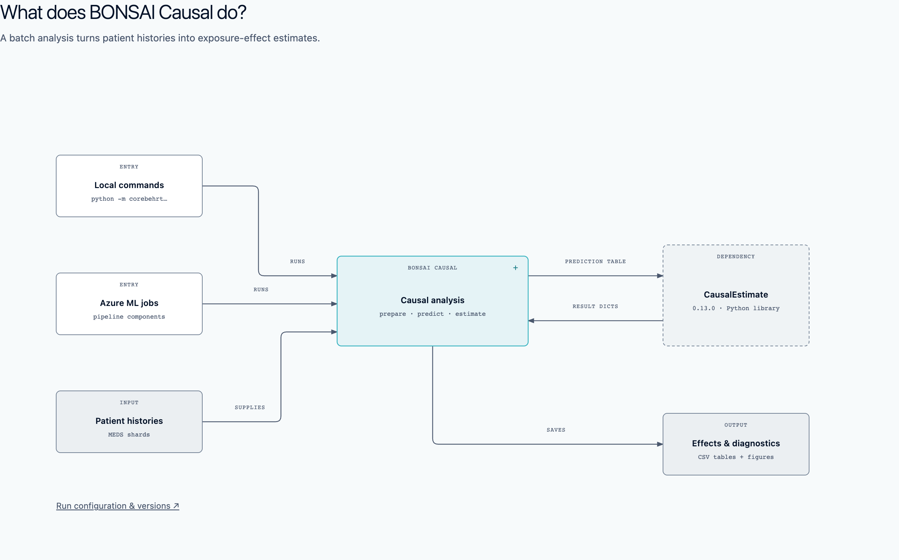

# BONSAI Causal architecture

Download this folder and open **[index.html](index.html)** in a browser. It works directly from `file://`, offline, without installation or a server. GitHub displays the PNG previews below; download the HTML to use the interactive document.

Click a component marked **+** to look inside. Underlined **↗** links open a related view. Up returns to the view you came from, including its focus and scroll position; Overview returns to the start. Breadcrumbs and browser Back/Forward follow the same history. Use Tab and Enter for navigation. On narrow screens, scroll the diagram horizontally. Reduced motion disables transitions.

| Question | Standalone HTML | PNG |
| --- | --- | --- |
| What does BONSAI Causal do? | [Overview](overview.html) | [Preview](overview.png) |
| What happens in one analysis? | [One analysis](analysis.html) | [Preview](analysis.png) |
| How does one fold produce predictions? | [One fold](fold.html) | [Preview](fold.png) |
| How do predictions become estimates? | [Effect estimates](estimation.html) | [Preview](estimation.png) |
| What controls configuration and versions? | [Configuration](config.html) | [Preview](config.png) |



The main paths are Overview → Causal analysis → Fold training & prediction → `finetune_fold()`, and Overview → Causal analysis → Effect estimation → `_estimate_effects()`. Training and prediction are separate responsibilities connected by a checkpoint. Configuration is a shared related view; it has no fixed parent.

## Evidence and limits

The diagrams describe code at **bonsai-causal `d97b5e9b83c0a3962494441542db9e7bbccef881`** (`origin/main`, refreshed 2026-09-21). The cross-repository estimator contract was checked against the required **CausalEstimate 0.13.0**, tag commit **`9193d476c58037fba7f4d047d03a577e84b6348e`**. Its refreshed main was `b38e07e2013ee33c05505df98044a62d1f25974e`; the diagrams intentionally describe the pinned release API.

[Source evidence](evidence.html) provides immutable GitHub links. [evidence.json](evidence.json) records claims, repository revisions, and the exact source excerpts. Each diagram has collapsed source references. Both source endpoints show the function, file, lines, and revision.

These are verified code relationships, not results from running the training pipeline or a statistical validity assessment. “Prepare patient data” groups sequence preparation and event-label creation; “Prepare causal cohort” groups selection and causal dataset preparation. These groupings are explanatory choices.

Direct package versions are pinned, but the environment is **not fully locked**: transitive dependencies and Azure additions are not all pinned. The environment builder registers `CoreBEHRT`, while `azure/util/job.py` selects `PHAIR_EHR@latest`; the diagrams do not assert that deployed Azure jobs use the builder's environment. External Azure resource state was not inspected. The `TMLE_TH` label is BONSAI's dispatch name for direct TMLE evaluation, not a separate CausalEstimate class. The bootstrap route uses resampling only when `n_bootstraps > 1`.

Omitted: transformer-layer internals, baseline models, simulation and repeated-study variants, cloud infrastructure, upstream converter repositories, and directory inventories. No shared `libs` boundary is asserted. No private data or other private repository material is included.

The saved aiomic light profile supplies the colors and type roles. Fonts resolve to Geist/Geist Mono when locally available, otherwise system sans/monospace; no font downloads are needed. Source code and component names are retained unchanged.

## Regenerate and verify

`build.py` owns diagram content, coordinates, source extraction and the explicit route map. `diagrams.css` owns presentation; `viewer.js` owns generic navigation. The build embeds the **same SVG strings** in the individual pages and `index.html`. Generated HTML is checked in; do not edit it directly. The entry point is itself self-contained and may also be copied alone (online source links are optional).

From the repository root, with the recorded commit available locally:

```sh
python3 docs/diagrams/build.py
ruff format --check docs/diagrams/build.py
ruff check docs/diagrams/build.py
node --check docs/diagrams/viewer.js
python3 /path/to/diagram-design/scripts/self_check.py \
  docs/diagrams/overview.html docs/diagrams/analysis.html \
  docs/diagrams/fold.html docs/diagrams/estimation.html docs/diagrams/config.html
```

For exports and interaction checks, provide Playwright and installed Google Chrome in a development environment. They are verification tools, not runtime dependencies:

```sh
# If playwright resolves normally:
node docs/diagrams/verify.mjs
# Or use an existing installation (absolute path to its index.mjs):
PLAYWRIGHT_MODULE=/path/to/playwright/index.mjs node docs/diagrams/verify.mjs
```

The browser script renders all five diagrams at 2× resolution, checks label bounds, exercises the navigation graph, keyboard and reduced-motion behavior, checks narrow-screen state restoration, compares standalone and embedded SVGs, and verifies source excerpts against Git. It rejects remote asset requests. `index.png`, `interaction.png`, and `narrow.png` show the viewer.

The skill's `self_check.py` applies to the five script-free diagram documents. The custom interactive entry point is tested by `verify.mjs`; its application navigation is outside the skill's canonical diagram-playback controller contract.

To adapt this package, use [PROMPT.md](PROMPT.md). Change diagram content and the route map; the viewer contains no repository-specific routing logic.
